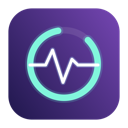
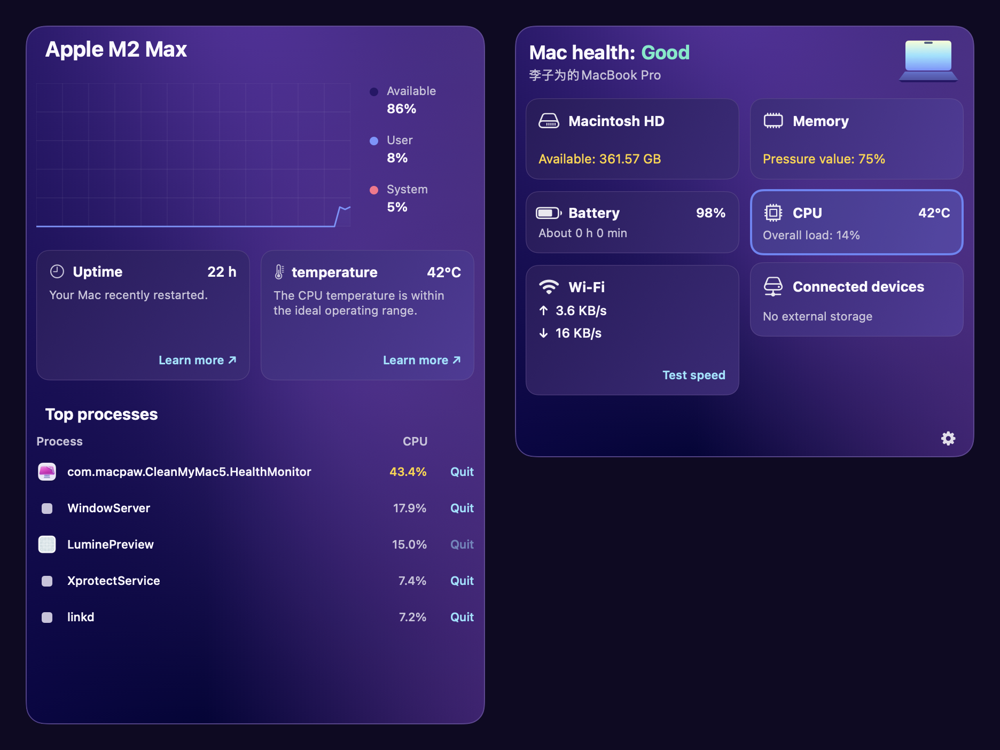
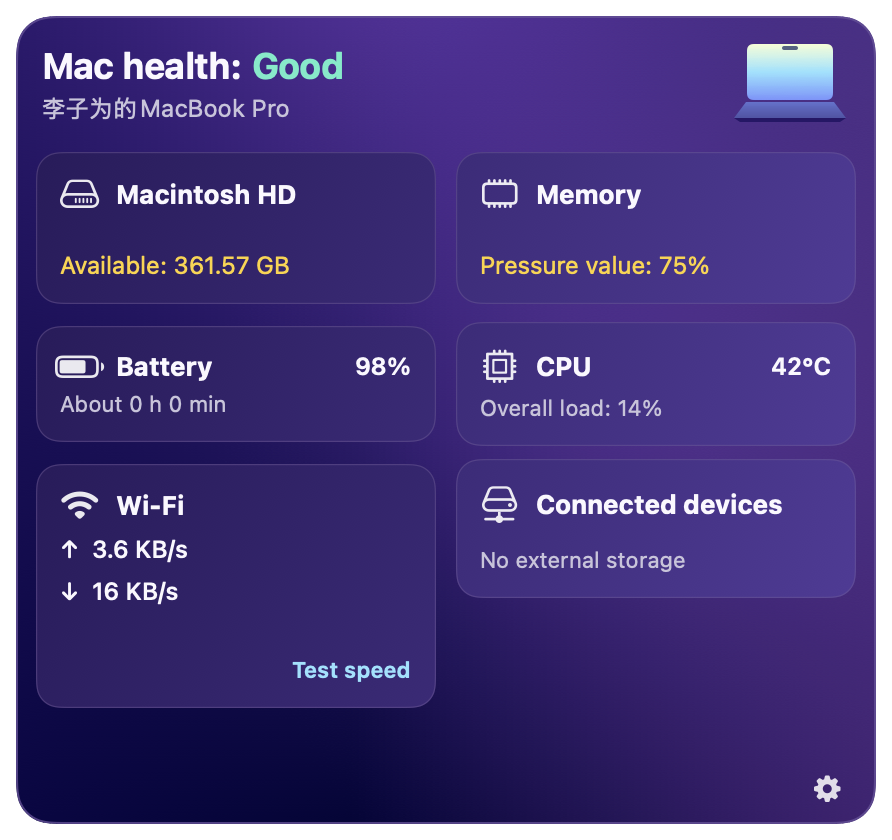

<p align="center"></p>
<h1 align="center">Lumine</h1>
<p align="center">システムの状態を、いつでも静かに見守る。</p>
<p align="center"><a href="README.md">English</a> · <a href="README.zh-CN.md">简体中文</a> · <a href="README.ru.md">Русский</a> · <strong>日本語</strong> · <a href="README.ko.md">한국어</a></p>

Lumine はネイティブのシステムモニターです。macOS ではメニューバー、Windows ではシステムトレイに常駐します。紫色のコンパクトなパネルで CPU、メモリ、ストレージ、バッテリー、ネットワークを確認し、カードをクリックすると詳細を表示できます。



*macOS 版の実際の SwiftUI ビューを、ローカルの実測値で描画した画像です。Windows 版は独立した WPF UI を使用しており、この画像には含まれません。*

<details>
<summary>システム概要（macOS）</summary>
<p></p>
</details>

## ダウンロード

[GitHub Releases](https://github.com/liziwei01/Lumine/releases/latest) から macOS ユニバーサル版（Apple Silicon／Intel）、Windows x64、Windows ARM64 をダウンロードできます。解凍してから実行してください。Windows 版はランタイムを含みます。macOS 版は一時署名のみで未公証、Windows 版は未署名です。

## 機能

| 項目 | macOS 13+ | Windows 10/11 |
| --- | --- | --- |
| CPU | 全体／論理コア別の使用率、履歴、稼働時間 | 全体の使用率、論理プロセッサ数、稼働時間 |
| メモリ | 使用量、空き容量、スワップ、プロセス順位 | 物理メモリの使用率と空き容量 |
| ストレージ | ボリューム容量、手動ファイル分類 | ローカルボリュームの空き容量／総容量 |
| バッテリー | 残量、状態、サイクル数、取得可能な温度 | 残量と電源接続状態 |
| ネットワーク | インターフェイス選択、速度、期間内の通信量、手動速度テスト | 各インターフェイスの速度と累積カウンター |
| 外部ストレージ | マウント済みのローカル外部ボリューム | Windows がリムーバブルと判定したボリューム |
| 設定 | 配色、ウィジェット、ソース、位置、更新間隔、ログイン起動 | 言語と更新間隔 |
| UI 言語 | 英、中（簡体／繁体）、露、日、韓、西 | 英、中（簡体）、露、日、韓 |

Windows 版は初期のネイティブ実装で、機能は macOS 版より少なくなっています。温度、SMART、ファイル分類、プロセス操作、速度テスト、ログイン起動は現在 macOS のみです。取得できない値は「取得できません」と表示します。固定ディスクと判定される USB ドライブはストレージの詳細に表示されます。

## ビルドと起動

### macOS

Xcode 15 以降をインストールし、`Lumine.xcodeproj` を開いて **Lumine** スキームを実行します。リポジトリのルートからもビルドできます。

```sh
xcodebuild -project Lumine.xcodeproj -scheme Lumine -configuration Release \
  -derivedDataPath build CODE_SIGNING_ALLOWED=NO build
codesign --force --sign - --timestamp=none build/Build/Products/Release/Lumine.app
open build/Build/Products/Release/Lumine.app
```

`Lumine.app` を `/Applications` にコピーしてください。メニューバーのディスプレイアイコンから開きます。Dock アイコンはありません。歯車メニューで設定や終了を選べます。固定の場所にインストールした後、一般設定でログイン時の起動を有効にできます。一時署名はローカルビルド用です。他の Mac への配布には適切な署名と公証が必要です。

### Windows

Windows に [.NET 10 SDK](https://dotnet.microsoft.com/download/dotnet/10.0) をインストールして実行します。

```powershell
dotnet run --project windows/Lumine.Windows -c Release
# ランタイムを含むポータブル版を作成
dotnet publish windows/Lumine.Windows -c Release -r win-x64 --self-contained true -o dist/windows-x64
```

出力フォルダー全体を保持し、`dist/windows-x64/Lumine.exe` を実行してください。ARM では `win-arm64` を指定します。ウィンドウを閉じるとトレイに格納され、アイコンをクリックすると再表示されます。「終了」で監視を停止します。設定は `%LOCALAPPDATA%\Lumine\settings.json` に保存されます。管理者権限、ドライバー、常駐サービスは不要です。

[ビルドワークフロー](.github/workflows/build.yml)は両プラットフォームをビルドし、Windows x64／ARM64 の成果物を生成します。x64 のスモークテストでは Windows の実測値を取得し、WPF の画像を出力します。今回の変更は macOS 上でクロスコンパイル済みですが、Windows での動作確認は Windows CI または実機の結果で判断してください。[Windows 実装の説明（英語）](docs/windows.md)。

## データとプライバシー

監視にはローカルのシステム API を使用します。アカウント、分析、テレメトリ機能はありません。CPU とネットワークの速度には 2 回の測定が必要で、初回は値が出ない場合があります。Windows の通信量はアダプターの累積カウンターであり、期間指定の履歴ではありません。再接続などでリセットされる場合があります。VPN・仮想アダプターは二重集計を避けるため個別に表示します。

macOS のファイル分類は「再スキャン」を押したときだけ実行し、フルディスクアクセスがない場合は結果が不完全になることがあります。キャッシュと通信履歴は `~/Library/Application Support/Lumine/`、設定は `~/Library/Preferences/app.lumine.monitor.plist` に保存します。手動速度テストは Cloudflare に接続し、約 28 MB を転送します。ゴミ箱の消去は確認後に内容を完全に削除します。プロセスへの終了要求により未保存データを失う場合があります。これらは自動実行されません。温度の取得可否はハードウェアとシステムのアクセス条件に依存します。

設定、指標の定義、権限、アンインストールは [macOS ガイド（中国語）](docs/macos.zh-CN.md)と[設計説明（中国語）](docs/architecture.md)を参照してください。

## 開発

```sh
dotnet run --project windows/Lumine.Core.Tests -c Release
dotnet build windows/Lumine.Windows -c Release
```

.NET 10 が必要です。macOS／Linux でのクロスコンパイルでは Windows アプリは実行できません。不具合報告には OS、リビジョン、該当する指標、再現手順を記載してください。翻訳は macOS が `Lumine/*.lproj/Localizable.strings`、Windows が `windows/Lumine.Windows/Localization.cs` です。対応プラットフォームや導入手順を変更する際は、5 言語の README を更新してください。

デザインは CleanMyMac のメニューバーモニターを参考にしています。Lumine は MacPaw とは無関係の独立プロジェクトで、同社の画像やブランド素材を含みません。要件とレビューは liziwei、設計・コード・文書は OpenAI Codex の支援を受けて作成しました。

## ライセンス

[MIT](LICENSE)。macOS センサープロトコルの参考資料は[サードパーティに関する記載](THIRD_PARTY_NOTICES.md)を参照してください。
