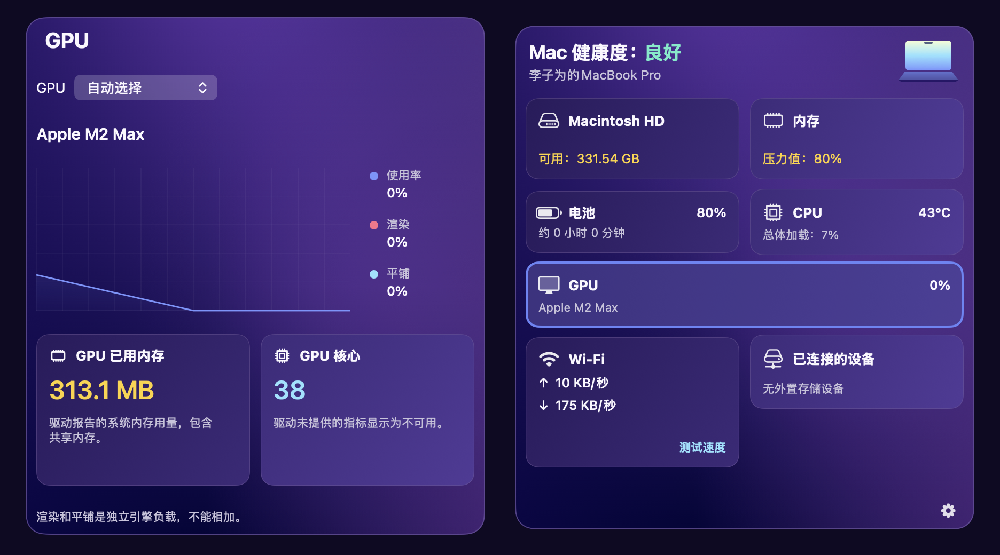

# Lumine v1.1.2

Lumine 是一个轻量的原生 macOS 菜单栏监控 App。点击菜单栏图标查看系统总览；点击卡片查看磁盘、内存、电池、CPU、GPU、网络和外置存储详情。

Lumine 的界面设计参考了 CleanMyMac 的菜单栏监控页面，尤其是深紫渐变、卡片、圆环图和详情浮层。Lumine 是独立的开源项目，与 MacPaw 或 CleanMyMac 没有关联；代码、图标和文案独立编写，不包含 CleanMyMac 的品牌素材，也不包含释放内存、防护或付费解锁功能。用户可明确点击清空废纸篓、请求排行进程退出和测试网速。

本项目由 liziwei 提出需求并审阅，使用 OpenAI Codex 协助完成架构设计、Swift 代码、文档和构建。

## 系统要求

- macOS 13 或更新版本
- Xcode 15 或更新版本（本项目在 Xcode 27 构建验证）

## 构建

```sh
xcodebuild -project Lumine.xcodeproj -scheme Lumine -configuration Release \
  -derivedDataPath build CODE_SIGNING_ALLOWED=NO build
codesign --force --sign - --timestamp=none build/Build/Products/Release/Lumine.app
```

生成的 App 位于 `build/Build/Products/Release/Lumine.app`。也可直接在 Xcode 中打开 `Lumine.xcodeproj` 运行。启动后没有 Dock 图标，请在菜单栏找显示器形状的图标。总览右下角的齿轮菜单只有“设置”和“退出”；退出会停止采样计时器并关闭 SMC 连接，Lumine 没有独立的后台进程。

安装时先从菜单栏退出旧版，再把构建产物 `Lumine.app` 复制到 `/Applications` 即可。“设置 → 通用”中可勾选“登录时启动 Lumine”；请在安装到固定位置后启用。若 macOS 要求批准，可从设置页打开系统登录项设置。取消勾选会移除登录项登记；完全卸载前也可在系统登录项设置中关闭它。删除 `/Applications/Lumine.app` 只移除程序本体。Lumine 还将文件类别缓存和最近网络流量写在 `~/Library/Application Support/Lumine/`，将设置写在 `~/Library/Preferences/app.lumine.monitor.plist`。要完全移除，请先退出 App，再删除 App 与这两个用户数据位置；如曾授予完全磁盘访问权限，可在 macOS 系统设置中移除对应记录。没有额外的后台 helper 或守护进程。

设置页可以改面板六点渐变、斜向柔光柱的颜色与位置、卡片渐变、边框、指标颜色，以及圆环光晕强度和范围，并实时预览。把圆环光晕强度设为 0 即可关闭。总览卡片在悬停时泛白、选中时泛蓝，两个填充强度可在“外观 → 卡片”中调整。开启“允许拖动监控面板”后，用标题栏的拖动手柄移动总览或任一详情；位置会分别保存。数据来源可以选择总体或单个逻辑 CPU 核心、CPU 温度平均值/最高值/指定传感器、网络接口、磁盘卷，以及内存可用量口径。面板打开和关闭时的采集间隔可分别设置，默认 5 秒和 30 秒，修改后立即生效。网络累计流量默认统计最近一小时，可改为 15 分钟至 24 小时。

自动采集项临时读取失败时，Lumine 会显示**同一来源**的上次有效值，默认最多保留 5 分钟；可在「设置 → 数据来源 → 采集与处理器」选择立即失效、1、5、10 或 30 分钟。保留期从上次成功读取开始计算，失败不会延长它。到期仍失败才显示“不可用”。实际为零的读数、正常断网和移除外置磁盘会立即更新。手动文件类别扫描与测速是独立快照，不参与此规则。

“通用 → 界面语言”支持跟随 macOS 首选语言，或手动选择简体中文、繁体中文、英语、日语、俄语、韩语和西班牙语。切换后界面立即更新，选择会保留到下次启动。翻译使用 App 包内的 `Localizable.strings`，运行时无第三方翻译包或联网请求。翻译资源可直接在 `Lumine/*.lproj/Localizable.strings` 中修改，欢迎开源协作者校对措辞。

“组件”设置页可分别隐藏总览卡片以及磁盘、内存、电池、CPU、GPU、网络和设备详情中的子组件。磁盘详情默认显示文件类别、SMART 运行状况、温度和废纸篓；额外的已使用/总容量和外置卷卡片默认隐藏，可在设置中打开。电池详情也有使用率排行，网络详情有测速区。监控浮层和设置页都没有滚动区域。详情由再次点击对应总览卡片或点击浮层外侧收起。

文件类别只在用户点击磁盘详情的“重新扫描”后遍历所选卷，完成的结果保存在本机 `Application Support/Lumine/disk-categories.json`。启动 App、打开详情和切换卷都只显示缓存，不会开始扫描。扫描中可以点击“停止”；旧缓存会一直保留到新扫描完整结束。要获取完整结果，请将稳定安装位置的 `Lumine.app` 加入 macOS“系统设置 → 隐私与安全性 → 完全磁盘访问权限”，然后重新打开 App 并手动重新扫描。废纸篓读取和释放也可能受此权限限制；若卡片显示“无法读取废纸篓”，点击“授权访问…”直接进入 macOS“完全磁盘访问权限”，将当前安装位置的 Lumine 加入列表并打开开关，然后退出并重新打开 App。右键点击此按钮还可在访达中定位当前 App，或选择当前卷的用户废纸篓文件夹（启动卷为 `~/.Trash`）；文件夹授权书签仅保存在本机。临时签名的 App 更新后可能需要重新授权：若开关已开启却仍无法读取，请移除旧记录，并重新添加当前 `/Applications/Lumine.app`。这个权限必须由用户在系统设置中授予。分类按目录位置，读取的是文件实际分配大小；APFS 克隆、快照和系统保留空间可能使分类总和与卷占用不同。

磁盘运行状况和温度从 macOS `diskutil info -plist` 报告的 SMART 字段读取。健康百分比是 `100 - PERCENTAGE_USED` 的寿命估算值，磁盘不提供该字段时只显示 SMART 状态或“不可用”。废纸篓“释放”会在确认后永久删除所选卷当前用户废纸篓中的内容，并报告失败项；启用条件是废纸篓中存在项目，零字节文件和空目录也可以释放。CPU、内存、磁盘等说明卡片中的“了解更多”会打开对应的 [MacPaw 官方知识库](https://macpaw.com/support/cleanmymac/knowledgebase/the-menu)。总览的 Mac 健康描述仅依据 Lumine 能采集的指标；不包含杀毒、更新检查或清理评分。

上面的第二条命令会为本地构建添加临时签名，便于 macOS 验证 App 包和手动授予完全磁盘访问权限。发布给其他 Mac 用户时，需要用自己的 Apple Developer 身份签名并公证；临时签名不能代替正式发布签名。

GPU 总览卡片可打开与 CPU 风格一致的使用率历史、渲染/平铺负载、已用系统内存和核心数。详情顶部可选择独立 GPU；切换来源后重新记录历史，不混合不同设备。组件页可隐藏 GPU 总览、图表、内存和核心数。GPU 数据来自本机 IOAccelerator 驱动的可选统计字段，各型号支持程度不同；未提供的指标显示“不可用”，Apple Silicon 的 GPU 内存包含共享内存，不等于独立显存容量。渲染和平铺百分比不能相加。暂不提供 GPU 温度或进程排行。可运行 `./scripts/test_gpu.sh` 验证 GPU 读数边界、缓存过期和设备隔离，运行 `./scripts/render_screenshots.sh` 渲染真实面板。



## 数据说明

日常监控数据由 macOS 本地接口、文件资源属性或系统自带的 `ps` 命令读取，不上传。CPU 根据每次采集内独立的至少一秒测量窗口计算，首次打开即可获取有效值，避免混入面板关闭期间的长时间平均；网络速率根据相邻采样计数器的差值计算。网络总量按分钟聚合并保存在本机；首次运行只能统计启动后的流量。CPU/内存/电池进程排行仅在对应详情打开时采集，最多每 10 秒运行一次 `ps`；电池排行用 CPU 活动量近似，不等于系统逐进程功耗。点击“关闭”会先核对进程身份，再请求正常退出，可能导致未保存的数据丢失。测速只在点击后经 HTTPS 使用 [Cloudflare Speedtest](https://github.com/cloudflare/speedtest) 的公开端点，约传输 28 MB，不自动运行。内存占用比例是根据物理页计算的估算值；压力百分比单独以（联动内存 + 压缩内存）/物理内存估算，排除可回收缓存和普通活跃页。压力提示优先依据 macOS 内核 `kern.memorystatus_vm_pressure_level` 的正常/警告/临界状态，读取不到时才按估算值提示。百分比不是 Apple 或 CleanMyMac 的官方数值，私有算法与采样时间仍会产生差异。Apple Silicon 的 CPU 温度优先从本机 HID 温度传感器读取，缺少专用核心传感器时显示 SoC 晶片温度；HID 不可用时尝试只读 AppleSMC。电池温度从电池注册表中的电池组数据读取。这些温度接口未获 Apple 公共 SDK 稳定性保证，持续读不到且超过设置的保留时间后显示“不可用”。Wi-Fi 名称受 macOS 隐私权限限制时可能显示通用名称“Wi-Fi”。外设列表只包含已挂载的本地外置存储卷。

架构与指标定义见 [架构设计](docs/architecture.md)。SMC 协议和传感器键的来源与许可见 [第三方声明](THIRD_PARTY_NOTICES.md)。`scripts/make_icon.swift` 可重新生成原创图标。开发者的参考截图留在公开 Git 仓库之外，不纳入源码或发布包。

## 许可

MIT，见 [LICENSE](LICENSE)。

运行 `./scripts/test_system.sh` 验证压力与占用分离、首次 CPU 测量、缓存过期、废纸篓统计/清空错误及符号链接安全；测试只删除临时目录中的测试文件。
