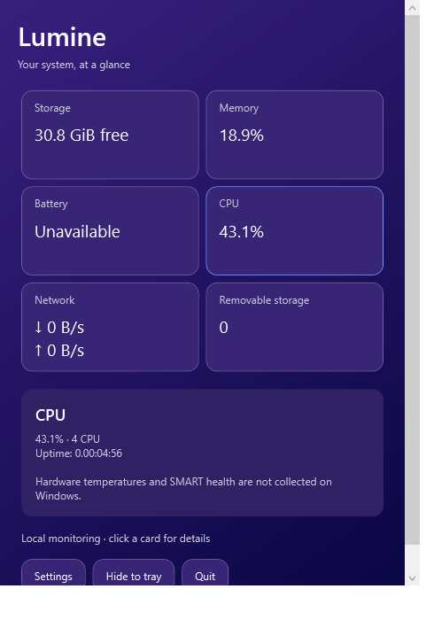

<p align="center"></p>
<h1 align="center">Lumine</h1>
<p align="center">Состояние системы всегда под рукой.</p>
<p align="center"><a href="README.md">English</a> · <a href="README.zh-CN.md">简体中文</a> · <strong>Русский</strong> · <a href="README.ja.md">日本語</a> · <a href="README.ko.md">한국어</a></p>

Lumine — нативный монитор системы: в строке меню macOS и в системном трее Windows. Компактная фиолетовая панель показывает загрузку CPU, память, диски, батарею и сеть. Нажмите карточку, чтобы открыть подробности.


*Изображение получено из настоящих представлений SwiftUI с текущими локальными измерениями. Версия для Windows использует отдельный интерфейс WPF и здесь не показана.*

<details>
<summary>Обзор системы (macOS)</summary>
<p></p>
</details>

<details>
<summary>Панель Windows (снимок из Windows CI)</summary>
<p></p>
</details>

## Скачать

Пакеты доступны в [GitHub Releases](https://github.com/liziwei01/Lumine/releases/latest): универсальный macOS (Apple Silicon и Intel), Windows x64 и Windows ARM64. Распакуйте архив перед запуском; Windows включает среду выполнения. macOS использует временную подпись без нотариализации; пакеты Windows не подписаны.

## Возможности

| Функция | macOS 13+ | Windows 10/11 |
| --- | --- | --- |
| CPU | Общая и поядерная загрузка, история, время работы | Общая загрузка, число логических процессоров, время работы |
| Память | Использование, доступная память, подкачка, процессы | Использование и доступная физическая память |
| Диски | Ёмкость томов, ручная классификация файлов | Свободное и полное место локальных томов |
| Батарея | Заряд, состояние, циклы, доступные температуры | Заряд и подключение к сети питания |
| Сеть | Выбор интерфейса, скорость, итоги за период, ручной тест скорости | Скорости и накопленные счётчики каждого интерфейса |
| Внешние диски | Подключённые локальные внешние тома | Тома, определённые Windows как съёмные |
| Настройки | Цвета, виджеты, источники, положение, опрос, автозапуск | Язык и интервал опроса |
| Языки интерфейса | Английский, китайский (упр./трад.), русский, японский, корейский, испанский | Английский, китайский (упр.), русский, японский, корейский |

Первая нативная версия для Windows имеет меньше функций. Температуры, SMART, категории файлов, действия с процессами, тест скорости и автозапуск пока доступны только в macOS. Отсутствующие показания отмечаются как недоступные. USB-диски, которые Windows считает фиксированными, отображаются в разделе дисков.

## Сборка и запуск

### macOS

Установите Xcode 15 или новее, откройте `Lumine.xcodeproj` и запустите схему **Lumine**. Либо выполните из корня репозитория:

```sh
xcodebuild -project Lumine.xcodeproj -scheme Lumine -configuration Release \
  -derivedDataPath build CODE_SIGNING_ALLOWED=NO build
codesign --force --sign - --timestamp=none build/Build/Products/Release/Lumine.app
open build/Build/Products/Release/Lumine.app
```

Скопируйте приложение в `/Applications`. Откройте его через значок монитора в строке меню; значка в Dock нет. Меню с шестерёнкой содержит настройки и выход. После установки можно включить автозапуск в общих настройках. Временная подпись подходит для локальной сборки; распространение на другие Mac требует надлежащей подписи и нотариализации.

### Windows

На Windows установите [.NET 10 SDK](https://dotnet.microsoft.com/download/dotnet/10.0) и выполните:

```powershell
dotnet run --project windows/Lumine.Windows -c Release
# Переносимая сборка со встроенной средой выполнения
dotnet publish windows/Lumine.Windows -c Release -r win-x64 --self-contained true -o dist/windows-x64
```

Запустите `dist/windows-x64/Lumine.exe`, сохранив все файлы выходной папки. Для ARM используйте `win-arm64`. Закрытие окна сворачивает приложение в трей; нажатие значка открывает его снова. Команда «Выход» завершает мониторинг. Настройки: `%LOCALAPPDATA%\Lumine\settings.json`. Права администратора, драйверы и фоновая служба не нужны.

[Рабочий процесс сборки](.github/workflows/build.yml) собирает обе платформы и создаёт артефакты Windows x64/ARM64. Проверка x64 считывает реальные показатели Windows и сохраняет снимок WPF. Нативный опрос и рендеринг WPF для Windows x64 прошли проверку в [Windows CI](https://github.com/liziwei01/Lumine/actions/runs/40080001959). ARM64 собран, но ещё не запускался на ARM-оборудовании. [Технические заметки Windows (англ.)](docs/windows.md).

## Данные и конфиденциальность

Lumine использует локальные системные интерфейсы, без аккаунтов, аналитики и телеметрии. Для скорости CPU и сети нужны два измерения; первое может быть недоступно. Сетевые итоги Windows — счётчики адаптера, которые могут сбрасываться при перезапуске, а не история за выбранный период. VPN и виртуальные адаптеры показаны отдельно, без двойного подсчёта.

В macOS классификация файлов запускается только вручную и может быть неполной без полного доступа к диску. Кэш и история сети находятся в `~/Library/Application Support/Lumine/`, настройки — в `~/Library/Preferences/app.lumine.monitor.plist`. Ручной тест скорости обращается к Cloudflare и передаёт около 28 МБ. Очистка корзины после подтверждения удаляет содержимое безвозвратно; завершение процесса может привести к потере несохранённых данных. Эти действия не запускаются автоматически. Доступность температур зависит от оборудования и системного доступа.

Настройки, определения показателей, разрешения и удаление описаны в [руководстве macOS (кит.)](docs/macos.zh-CN.md) и [архитектуре (кит.)](docs/architecture.md).

## Разработка

```sh
dotnet run --project windows/Lumine.Core.Tests -c Release
dotnet build windows/Lumine.Windows -c Release
```

Для проверок нужен .NET 10. Кросс-компиляция на macOS/Linux не запускает приложение Windows. В отчёте об ошибке укажите ОС, ревизию приложения, показатель и шаги воспроизведения. Переводы macOS находятся в `Lumine/*.lproj/Localizable.strings`, Windows — в `windows/Lumine.Windows/Localization.cs`. При изменении поддержки платформ и установки обновляйте все пять README.

Дизайн вдохновлён монитором CleanMyMac. Lumine — независимый проект, не связанный с MacPaw и не содержащий его графических материалов. Требования и проверка: liziwei; архитектура, код и документация созданы с помощью OpenAI Codex.

## Лицензия

[MIT](LICENSE). Источники протоколов датчиков macOS: [сторонние материалы](THIRD_PARTY_NOTICES.md).
